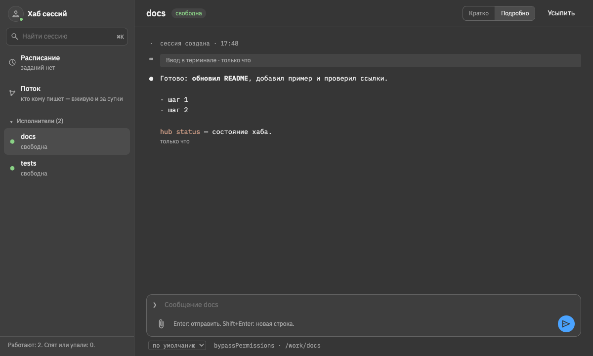

# Dark Optimized — a dark theme for Agents Hub

> Original author: [@Scremliss](https://github.com/Scremliss) · upstream: [Scremliss/hub-plugin-dark-optimized](https://github.com/Scremliss/hub-plugin-dark-optimized). This is the copy the Hub catalog installs; the author's updates are taken into it from upstream.

A plugin without code: only a theme. A neutral dark gray background, light high-contrast text, calm accents — a
palette in the spirit of the Dark+ dark theme of the editor (VS Code / Cursor). For long work in the evening: easier on
the eyes than black.

## Colors

| What | Color |
|---|---|
| Background | `#363636` |
| Panels | `#3e3e3e` |
| Blocks | `#444444` |
| Borders | `#555555` |
| Text | `#f0f0f0` (contrast with the background about 9:1) |
| Accent | `#4aa3ff` |
| Success / warning / error | `#89d185` / `#e0b83c` / `#ff6b6b` |
| Code | `#e0a98f` |

## Install

In Agents Hub: "Settings" → "Plugins" → "Find" → "Dark Optimized", then "Settings" → "Look" → "Theme" → "Dark Optimized".
Or tell the hub: "install the dark-optimized theme" (`hub market install <account>/<repo>`). The theme choice is kept
in the browser.

## Your own colors

Open `dark-optimized.json`: the values are the page's `tokens.css` variables (`background`, `foreground`, `primary`, …).
Colors that are not set are derived by the hub from the background, the text and the accent. The format is in the hub's
`EXTENDING.md` ("Themes").

## Credits

The palette idea comes from the Dark+ (VS Code) and Dark+ Optimized dark themes; the colors here are our own, picked for
the hub page. License — MIT.
